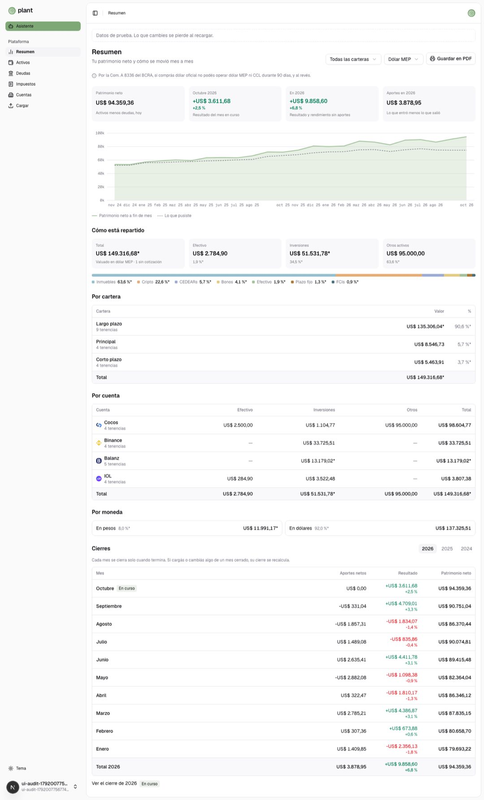

# UI audit

Where the data pages stand against [`docs/ui.md`](ui.md), before the design-system work. Phase 1 of the frontend review: nothing in the app changed.

Captured from the prototype (`next dev`, made-up data) at 1440px and 390px, light and dark, on 2026-10-14. Screenshots are in [`ui-audit/`](ui-audit/), named `<screen>--<desktop|mobile>-<light|dark>.jpg`. The round "N" at the bottom left of the mobile captures is Next's dev indicator, not the app.

States the fixtures do not reach (met price alerts, pinned charts, a failed read, "Calculando…", a user with no data) were audited from the code.

## The short version

1. **No hierarchy on Resumen.** Net worth is one of eight equal grey tiles, and a second, larger "Total" (assets, US$ 149.316) sits right under the first one (net worth, US$ 94.359). Five sections of the same weight follow.
2. **Seven surface treatments on one page** (Resumen): dashed box, bordered section, grey tile, bordered table, bordered "currency" box, bordered chart card, bordered error paragraph. The problem on Resumen is too many kinds of box side by side, not deep nesting. Nesting shows up in Ajustes, Cargar and the account page.
3. **Notices have no component.** One MEP disclaimer, three amber boxes built three ways, a green success box, red `FormAlert` text used for failed reads, and an asterisk footnote that Resumen uses without ever explaining it.
4. **The same thing is built 3–5 ways:** year switchers, page titles, back navigation, section headings, status badges, row actions, footnotes and empty states (table below).
5. **The type and spacing scale in `docs/ui.md` is not followed:** pages stack at `gap-6`, sections at `gap-3`, section titles are `text-base` (the doc says `text-lg`), and `gap-3` appears 85 times.
6. **Semantic colour tokens go unused.** `--gain`, `--loss` and `--warn` exist in `globals.css`, yet pages reach for `amber-*` and `emerald-*` (32 hits).

## Resumen

Files: `app/(app)/(data)/summary-view.tsx`, `components/summary/*`, plus `holdings/assets-summary.tsx`, `holdings/sum-text.tsx` and `holdings/mep-notice.tsx`.

Also captured: [desktop dark](ui-audit/summary--desktop-dark.jpg), [mobile light](ui-audit/summary--mobile-light.jpg), [mobile dark](ui-audit/summary--mobile-dark.jpg), and one portfolio ([`?portfolio=`](ui-audit/summary-portfolio--desktop-light.jpg)).

### Surfaces

The page reads top to bottom as 13 blocks. Depth counts the borders, fills or shadows stacked on each block, counting from the page canvas.

| Block                                   | Treatment today                                                             | Depth | Verdict                                                                                                                                                               |
| --------------------------------------- | --------------------------------------------------------------------------- | ----- | --------------------------------------------------------------------------------------------------------------------------------------------------------------------- |
| "Datos de prueba" note                  | dashed border box                                                           | 1     | Dev only. It should become a `Notice` `info` banner so it stops inventing a sixth box style                                                                           |
| Page header                             | none                                                                        | 0     | Keep                                                                                                                                                                  |
| MEP disclaimer                          | icon + `text-xs` muted line                                                 | 0     | Shown on every MEP view, the default unit, so it is permanent noise. See Notices                                                                                      |
| Met price alerts (`met-alerts.tsx`)     | `rounded-lg border p-3` section, `text-sm` h2                               | 1     | A list inside a bordered box with its own heading scale. It should be a `Notice` `info` with the list and one link                                                    |
| Four KPI tiles                          | `bg-muted/60` tiles                                                         | 1     | Net worth gets the same weight as three secondary figures. Make it the page's hero figure (no tile) with the three others as smaller figures beside it                |
| Net-worth chart                         | none, `figcaption` legend                                                   | 0     | Good. The legend sits below the chart, away from the lines it names                                                                                                   |
| Pinned charts (`pinned-charts.tsx`)     | `ChartCard` `rounded-lg border p-3`; a failed one is a bordered muted `
` | 1     | A card is right for a pinned object. The failure should be an `EmptyState` inside the same card, not a different box                                                  |
| "Cómo está repartido"                   | h2 + four more `bg-muted/60` tiles + distribution bar                       | 1     | The "Total" tile (assets) reads as a second, bigger net worth. Rename it "Activos", or drop it and let the bar carry the split                                        |
| Por cartera                             | `DataTable` (hairline border)                                               | 1     | Good on its own                                                                                                                                                       |
| Por cuenta                              | `DataTable`                                                                 | 1     | Good on its own                                                                                                                                                       |
| Por moneda (`currencies-breakdown.tsx`) | two `rounded-lg border p-3` boxes                                           | 1     | A seventh box style for two numbers. They belong as rows of a table, or as a two-part bar like the class split                                                        |
| Cierres                                 | h2 + custom year buttons + description + `DataTable` + link + badge         | 1     | The table is fine. The year switcher is a third design, next to Activos's tabs and Impuestos's years                                                                  |
| `?portfolio=` view                      | same tiles + Por cuenta + Por moneda + footnote                             | 1     | Duplicates `/portfolios/[id]` almost line for line (compare [this](ui-audit/summary-portfolio--desktop-light.jpg) with [this](ui-audit/portfolio--desktop-light.jpg)) |

Nothing here sits more than one level deep. What needs cutting is the number of _sibling_ box styles (7) and section headings of equal weight (6: Cómo está repartido, Por cartera, Por cuenta, Por moneda, Cierres, Gráficos fijados).

### Buttons and controls

| Control                          | Today                                     | Should be                                                                                                                                          |
| -------------------------------- | ----------------------------------------- | -------------------------------------------------------------------------------------------------------------------------------------------------- |
| Portfolio `FilterSelect`         | header                                    | Keep: it is the page's scope                                                                                                                       |
| `UnitSelect`                     | header                                    | Keep                                                                                                                                               |
| "Guardar en PDF"                 | outline button with label, `h-9` override | A secondary action: an `IconButton` (printer, tooltip "Guardar en PDF") or the page's `⋯` menu. On mobile it currently wraps onto a row of its own |
| Year buttons (2026/2025/2024)    | hand-made `<button>`s with `bg-muted`     | The `Tabs` segmented control from `docs/ui.md`, shared with Impuestos                                                                              |
| "Ver el cierre de 2026" + badge  | text link under the table                 | Keep as a link, but in the section's header row or as the footer row's link (the footer already links "Total 2026", so this link is redundant)     |
| "Listo" per met alert            | ghost text button                         | `IconButton` (check, tooltip "Marcar como visto"), per the row-actions rule                                                                        |
| "Ver o crear alertas en Ajustes" | muted `text-xs` link                      | The alert notice's single action                                                                                                                   |
| "Soltar" per pinned chart        | ghost text button under the card          | `IconButton` (pin-off) in the card's header row                                                                                                    |

Today a full page shows 2 selects, 1 labelled button and 3 year buttons, plus up to 2 text buttons per alert and per pin. The target is the 2 selects, 1 icon and the segmented years.

### Notices, errors and states

| Case                                 | Today                                                                                                                                                                               | What it should say, and how                                                                                                                                                                                                         |
| ------------------------------------ | ----------------------------------------------------------------------------------------------------------------------------------------------------------------------------------- | ----------------------------------------------------------------------------------------------------------------------------------------------------------------------------------------------------------------------------------- |
| MEP regulation (Com. A 8336)         | `MepNotice`: icon + muted `text-xs`, on every MEP page (Resumen, Activos, Deudas), placed differently on each (under the header here, under the filters in Activos)                 | Reference info, not page state. Put it once behind an info icon beside `UnitSelect` (tooltip or popover), or as a page footnote. Do not repeat it as a line on every page                                                           |
| Holdings without a quote             | an asterisk on every affected figure (sr-only "incompleto") and "· 1 sin cotización" inside the Total tile's note. Resumen never explains the asterisk; Activos does, in a footnote | A `Notice` `warning` inline at the top of "Cómo está repartido": "A 1 tenencia le falta cotización: los totales no la incluyen", with the action "Cargar precio" (to Activos). Keep the asterisks and give them the shared footnote |
| Net worth missing quotes             | the tile note changes to "…, sin lo que no tiene cotización"                                                                                                                        | The same warning `Notice`. A warning inside a tile note goes unread                                                                                                                                                                 |
| Met price alerts                     | bordered section with a bell heading                                                                                                                                                | `Notice` `info` (bell icon), title "Tus alertas de precio", the list, one action. `role="status"`                                                                                                                                   |
| Alerts could not be read             | `FormAlert` (red `text-sm`, `role="alert"`) inside the alerts box                                                                                                                   | `Notice` `error`: "No pudimos leer tus alertas de precio." with the action "Recargar". `FormAlert` is for a field's error (`docs/ui.md`)                                                                                            |
| A pinned chart could not be drawn    | bordered muted paragraph                                                                                                                                                            | `EmptyState` inside the chart card's frame, with "Soltar" still available                                                                                                                                                           |
| Close recalculated                   | `CloseStatus`: `bg-amber-500/15 text-amber-700`                                                                                                                                     | A `Badge` `warning` on the token                                                                                                                                                                                                    |
| Close in progress / closed / partial | three hand-built chips (`bg-primary/15`, `bg-muted`, `bg-muted`)                                                                                                                    | `Badge` `neutral` / `info`                                                                                                                                                                                                          |
| "Calculando…"                        | plain text in place of the figure (`sum-text.tsx`)                                                                                                                                  | Muted and `aria-busy`, or a `Skeleton` the width of a figure in tiles. Text in the figure's font reads as a value                                                                                                                   |
| No data yet (new user)               | no empty state. The tiles render only `if (current && thisYear)` and the chart needs 2+ months, so a new user gets a header, empty sections and empty tables                        | One `EmptyState` for the page: icon, "Todavía no cargaste nada", action "Cargar" (to `/import`)                                                                                                                                     |

### Type and spacing against `docs/ui.md`

| Where                           | Today                                                     | Doc                                                               |
| ------------------------------- | --------------------------------------------------------- | ----------------------------------------------------------------- |
| Page stack (`summary-page.tsx`) | `gap-6`                                                   | `gap-10` between sections, `gap-4` between blocks                 |
| Section internals, tile grids   | `gap-3`                                                   | `gap-2` / `gap-4`                                                 |
| Header row                      | `gap-3`                                                   | `gap-2` / `gap-4`                                                 |
| Page title                      | `text-xl`                                                 | not defined (every page uses `text-xl`: codify it)                |
| Section titles                  | `text-base`                                               | `text-lg`                                                         |
| Alerts title                    | `text-sm`                                                 | `text-lg`                                                         |
| Tile label and note             | `text-[11px]`                                             | the tiles rule says 11px, the scale says `text-xs`: settle on one |
| Tile value                      | `text-base` semibold, the same size as the section titles | no size: the hero figure needs its own step (`text-3xl`)          |
| `PrintButton`                   | `className="h-9"` overrides `size="sm"`                   | `size="sm"`                                                       |

### Proposed order of Resumen

1. Header: title, description, portfolio and unit selects, `⋯` menu (Guardar en PDF).
2. Notices, only when they apply: met alerts (info), missing quotes (warning), failed reads (error).
3. **Net worth**: the figure large, then the month's result, the year's result and the year's contributions as secondary figures in one row. No tiles.
4. The chart, right below the figure it explains.
5. **Distribution**: the class bar with its legend, then one switcher (Cartera · Cuenta · Moneda) over a single `DataTable`, which replaces three sections and two box styles.
6. **Closes**: section header with the segmented year control, then the table. The footer row links the year.
7. Pinned charts, as cards, last (or after the chart if Tomas prefers them up top).

## The other screens

### Activos — [desktop](ui-audit/assets--desktop-light.jpg) · [mobile](ui-audit/assets--mobile-light.jpg)

- Header: two labelled buttons ("Agregar movimiento" outline, "Agregar tenencia" primary). Fine as one primary and one secondary, but no other page does it.
- Tiles + bar: identical to Resumen's "Cómo está repartido" (the same component; good).
- The MEP line sits between the filters and the table, so on this page it splits the controls from the data.
- The price column overflows into the cost column ("US$ 61,00 c/100 VN", "US$ 0,824074 c/100 US$"). The quantity column cuts "US$ 95.000,…".
- Row actions vary from 1 to 3 icons per row (edit/property/delete, transfer, edit/refresh/delete) at fixed slots, so the icons do not line up and the column holds three slots on every row. Three icons breaks the "two, then `⋯`" rule.
- "Corregir" and "Cargar precio" are muted text links under the price.
- Mobile: names cut to 6–7 characters ("Departa…") because the actions keep three slots, and the tab bar clips "Ventas".
- The only page that explains the asterisk (a footnote under the table).

### Instrument — [desktop](ui-audit/instrument--desktop-light.jpg)

- Eight tiles in two rows. The second row has no notes, so its tiles are shorter and the rows do not match.
- A prose line under the tiles carries figures ("Pusiste US$ 17.278,28 y sacaste…") that belong in a tile note.
- The "Incluir en el reporte" switch floats at half width between the header and the tiles.
- "Historial" is the closest thing in the app to the target `Section` pattern: heading, description and button in one row.
- A back link ("← Activos") and a breadcrumb that both say "Activos".

### Cuentas — [desktop](ui-audit/accounts--desktop-light.jpg)

- The page that follows `docs/ui.md` best: two sections, each a heading, description and add button over a `DataTable`.
- The add buttons use different verbs ("Agregar cuenta", "Nueva cartera").
- The `h1` is `sr-only` and the first section heading stands in for it, while the other pages show one.

### Cuenta and Cartera — [account](ui-audit/account--desktop-light.jpg) · [portfolio](ui-audit/portfolio--desktop-light.jpg)

- The back link on the account page says "← Activos" while the breadcrumb says "Cuentas".
- The portfolio page's breadcrumb is empty.
- The connection card (account) is a full bordered card with a filled primary button, so it outranks the account's own figures. It should be a `Notice` `info` with a secondary action, or a `Section`.
- "Tenencias" and "Movimientos" have headings without descriptions or actions; "Ver más" is an outline button under the table.

### Deudas — [desktop](ui-audit/debts--desktop-light.jpg)

- Close to the target: header, tiles, one section with a heading, description and add button, a `DataTable` with two icons per row.
- Two of the four tiles are counts ("Deudas 4", "Con cuota 2") that the table already shows.
- The MEP line again, on a page about debts.

### Cierres — [month](ui-audit/close-month--desktop-light.jpg) · [year](ui-audit/close-year--desktop-light.jpg)

- The breadcrumb is empty.
- Eight tiles in two rows. Values sit at different heights because some tiles have a percent line and some do not ("US$ 86.370,44" against "+US$ 4.709,01").
- The status chip next to the title is one of the three hand-built chips.
- No unit select, while every other valued page has one.

### Impuestos — [desktop](ui-audit/taxes--desktop-light.jpg) · [dark](ui-audit/taxes--desktop-dark.jpg)

- The only page whose disclaimer looks like a callout (amber fill and border, info icon), built inline with raw amber colours.
- The year switcher sits in the header, built like Resumen's but not shared with it.
- No page description.
- Bienes Personales has three tiles, Ganancias has one at a third of the width: the tile grid changes from section to section.
- Methodology is a bulleted `text-xs` list under each table: a footnote pattern of its own.
- "Bajar CSV" (outline, labelled) per section and "Guardar en PDF" in the header: three labelled buttons on the page.

### Cargar and the review — [upload](ui-audit/import--desktop-light.jpg) · [list](ui-audit/import-list--desktop-light.jpg) · [review](ui-audit/import-review--desktop-light.jpg)

- The upload area is a bordered section holding a dashed dropzone that holds two buttons: a card inside a card.
- The list's status cell stacks a chip ("Lista para revisar") over a "Revisar" button, so the row is twice as tall as the others.
- The review's "does not add up" warning is an amber border without fill, the third amber treatment (Impuestos has a fill, `left-out-notice.tsx` a thicker border and padding).
- The review rows are bordered cards, one per holding, not a table. The doubtful one gets an amber fill.
- "Descartar" is a text button with an icon on every row; the row-actions rule says an icon.

### Asistente — [desktop](ui-audit/assistant--desktop-light.jpg)

- Nine full-width bordered suggestion buttons stacked: the heaviest block on the page, above the composer.
- No visible title (the `h1` is `sr-only`); the conversation select is the header.

### Ajustes — [desktop](ui-audit/settings--desktop-light.jpg)

- The only page built from shadcn `Card` (`rounded-xl`, `shadow-sm`, `py-6`): a radius, shadow and padding no other page uses.
- "Seguridad" is half width and every other card is full width.
- "Dólar de hoy" puts three bordered rows, each with an outline "Corregir" button, inside its card: a card inside a card.
- "Tus datos" is a wall of five buttons (one primary, four outline).
- "Borrar tu cuenta" gets its own card with a destructive button. A danger zone is a real pattern, but it should be a `Section` with a separator, not one more card.

## The same thing, built N ways

| Thing            | Ways  | Where                                                                                                                                                                                                                                                          |
| ---------------- | ----- | -------------------------------------------------------------------------------------------------------------------------------------------------------------------------------------------------------------------------------------------------------------- |
| Page title       | 3     | visible `text-xl` `h1` (Resumen, Activos, Deudas, Cargar, Impuestos, Cierres, instrument, scope pages); `sr-only` `h1` with a section heading standing in (Cuentas, Ajustes, Asistente); breadcrumb empty (Cartera, Cierres)                                   |
| Page description | 2     | present (Resumen, Activos, Deudas, Cargar, review) or absent (Impuestos, Cierres, Ajustes)                                                                                                                                                                     |
| Back navigation  | 2     | breadcrumb alone, or breadcrumb plus a "← X" link whose label sometimes disagrees with it (account page)                                                                                                                                                       |
| Section heading  | 4     | `text-base` h2 (Resumen, Tenencias/Movimientos), `text-lg` with description and button (Cuentas, Deudas, Historial), `CardTitle` (Ajustes), `text-sm` with an icon (met alerts)                                                                                |
| Figure tiles     | 1 + 3 | one `SummaryTile` everywhere (good), but rows of 4, 3 and 1, optional notes that misalign the values, and Resumen's bordered currency boxes beside them                                                                                                        |
| Period switcher  | 2     | hand-made year buttons (Resumen closes, Impuestos header) and the `Tabs` segmented control (Activos)                                                                                                                                                           |
| Unit select      | 5     | in the header with other controls (Resumen), alone on the right (Deudas, account, portfolio, instrument), in the filter row as "Valuar en" (Activos), inside the composer (Asistente), missing (Cierres)                                                       |
| Export           | 3     | "Guardar en PDF" (Resumen, Impuestos), "Bajar CSV" per section (Impuestos), the button wall in Ajustes                                                                                                                                                         |
| Info notice      | 4     | `MepNotice` muted line, Impuestos's amber box, the dashed prototype note, `api-key-card`'s `bg-gain/10` success box                                                                                                                                            |
| Warning notice   | 3     | amber border (review), amber border + fill (Impuestos), amber border + `p-4` (`left-out-notice.tsx`)                                                                                                                                                           |
| Error            | 3     | `FormAlert` red text (right under a dialog's field; also used for failed reads and refused actions outside any form, as in `met-alerts.tsx` and `movements-table.tsx`), `text-destructive` inline (import list, `api-key-card`), a bordered muted box (charts) |
| Status chip      | 5     | `CloseStatus` (three colours), `PartialMark`, the import status chip, review's "1 dudosa", Cuentas's plain "Incluida"                                                                                                                                          |
| Empty state      | 3+    | a muted `
` ("Todavía no subiste nada."), the setup screens (`assets-setup`, `debts-setup`), nothing (Resumen, pinned charts)                                                                                                                                |
| Row action       | 2     | `IconButton`s (Cuentas, Deudas, Activos, Historial) and labelled text buttons ("Listo", "Soltar", "Descartar", "Corregir", "Revisar")                                                                                                                          |
| List             | 2     | `DataTable`, or a stack of bordered rows (review holdings, Ajustes rates, Resumen currencies, assistant suggestions)                                                                                                                                           |
| Footnote         | 4     | an asterisk line (Activos), bulleted `text-xs` lists (Impuestos), a `text-xs` paragraph (Resumen with a portfolio, closes), none even though asterisks are shown (Resumen)                                                                                     |
| Gain/loss colour | 2     | `text-emerald-700 dark:text-emerald-400` in `sum-text.tsx`, `figures.tsx` and `import-review.tsx`, while `--gain` exists and `api-key-card` uses it                                                                                                            |

## Hand-rolled patterns in the code

Counts over `apps/web/src/{app,components}/**/*.tsx`, leaving out tests and `components/ui`.

| Pattern                                   | Hits | Files | Candidate                                                                      |
| ----------------------------------------- | ---- | ----- | ------------------------------------------------------------------------------ |
| `text-amber-*`                            | 19   | 6     | `Notice` `warning`, `Badge` `warning`                                          |
| `bg-amber-*`                              | 7    | 5     | same                                                                           |
| `border-amber-*`                          | 6    | 5     | same                                                                           |
| `text-emerald-*`                          | 5    | 3     | the `--gain` token (`text-gain`)                                               |
| `text-destructive` (outside `ui`)         | 6    | 5     | `Notice` `error`; `text-loss` for figures                                      |
| `<FormAlert` in files with no dialog      | 10   | 10    | `Notice` `error` where it is not a field's error (keep `FormAlert` for fields) |
| `rounded-lg border` / `rounded-xl border` | 19   | 16    | `Section` (no box), `Card` only for objects, `Notice`                          |
| `<Card`                                   | 35   | 7     | Ajustes and the MFA page: `Section`                                            |
| `bg-muted` (outside `ui`)                 | 15   | 13    | `Badge`, `StatTile`, the segmented control                                     |
| `border-dashed`                           | 3    | 3     | the prototype note (`Notice`), the dropzone (keep), the chart legend (keep)    |
| `text-xl font-semibold`                   | 10   | 10    | `PageHeader`                                                                   |
| `text-base font-semibold`                 | 18   | 12    | `Section` (`text-lg`)                                                          |
| `gap-3`                                   | 85   | 29    | the scale (`gap-2` / `gap-4`)                                                  |
| `gap-6`                                   | 17   | 15    | the scale (`gap-4` / `gap-10`)                                                 |
| `TriangleAlert`                           | 13   | 5     | `Notice` `warning` owns the icon                                               |
| `role="alert"` by hand                    | 0    | 0     | (only through `FormAlert`, which forces it)                                    |

## What phase 2 needs

- **Tokens**: use the existing `--warn`, `--gain` and `--destructive` for notices and badges, with `--primary` for info, keeping text in the foreground colour so contrast does not depend on the variant.
- **`Notice`** (`info` / `warning` / `error` / `success`): an icon, an optional title, text and an optional action, on a faint tint of the token with a hairline border. `role="status"` by default, `role="alert"` for `error` raised by an action. Inline in a section, or as a page banner above the content.
- **`EmptyState`**: an icon, one line and one action.
- **`PageHeader`**: back link, title (`text-xl`), description, and a slot for filters and one action plus `⋯`. It replaces 10 hand-built headers and fixes the empty breadcrumbs.
- **`Section`**: heading (`text-lg`), description and actions on one row, with no box.
- **`StatTile`** and `StatGrid`, plus a hero variant for net worth: values aligned to the top whatever the note, and one grid that keeps its columns when a section has fewer tiles.
- **`Badge`** (`neutral` / `info` / `warning` / `success` / `error`) for the five status chips.
- **`Segmented`**, shared by the year switchers and the tabs.
- **`Footnotes`**, for the asterisk and the methodology lists.

## Decisions for Tomas

Each one has the default I would take.

1. **Merge Por cartera / Por cuenta / Por moneda** into one switcher over one table on Resumen. Default: yes.
2. **MEP disclaimer**: once, behind an info icon next to the unit select, instead of a line on every MEP page. Default: yes. It stays one click away wherever the unit is MEP.
3. **`/?portfolio=`** duplicates `/portfolios/[id]`. Default: keep the filter (it is how Resumen scopes) but build both from the same components; no redirect.
4. **New colour tokens** (warning, info, success, loss). Default: add them in the first phase 2 PR.
5. **Ajustes** loses its `Card`s for `Section`s with separators. Default: yes, in the PR after Resumen.

## Seen in passing (not presentation, left alone)

- The net-worth chart's month axis drops or overlaps labels: "sep 25" is missing at 1440px, and at 390px "jul 25" and "oct 25" collide and "oct 26" is cut off.
- In Activos the price column overflows into the cost column for prices quoted per 100 nominal ("c/100 VN", "c/100 US$").
- The portfolio page and the close pages render an empty breadcrumb.
- In the fixtures the net-worth tile says it is complete ("Activos menos deudas, hoy") while the assets total under it is marked incomplete ("1 sin cotización"). Worth checking whether the net worth leaves out the unquoted holding without saying so.
